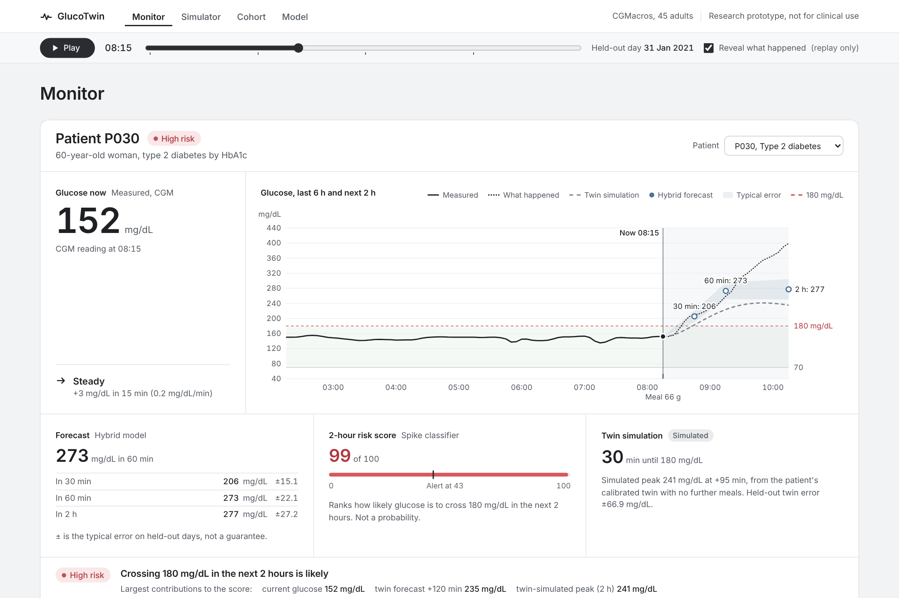
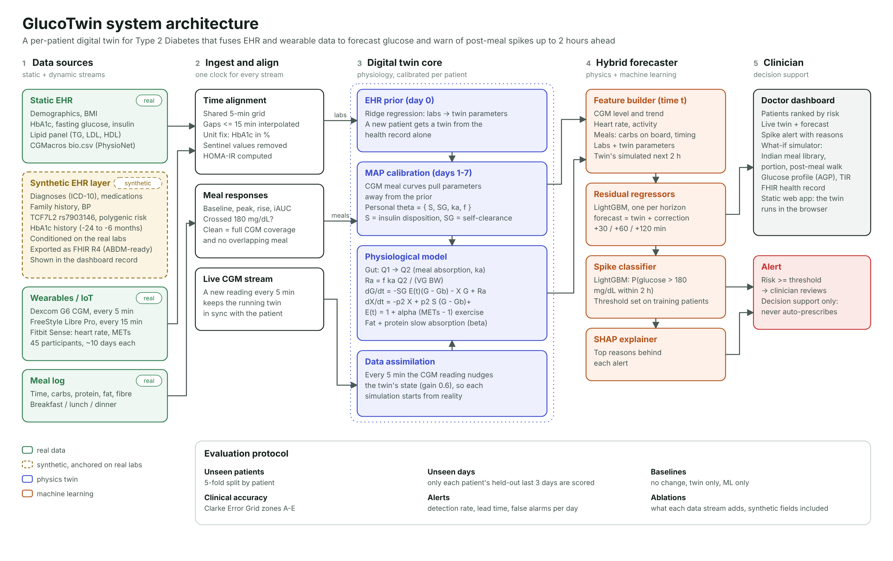
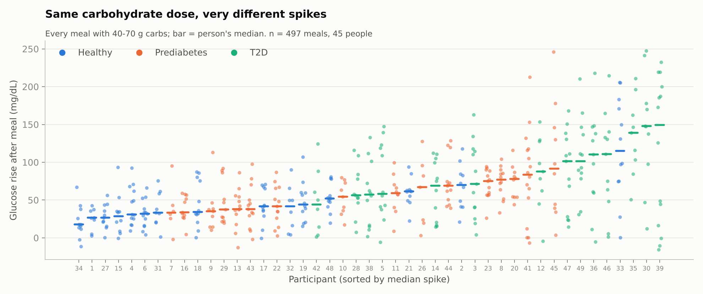
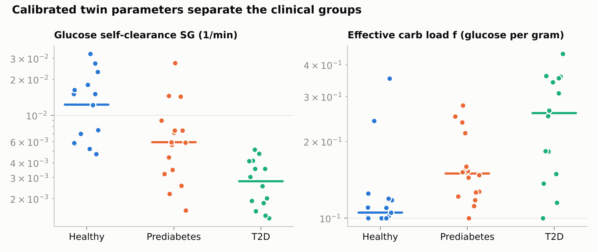
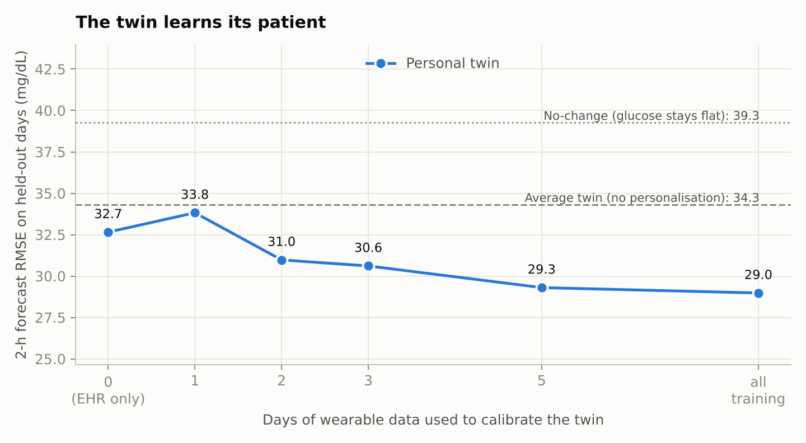
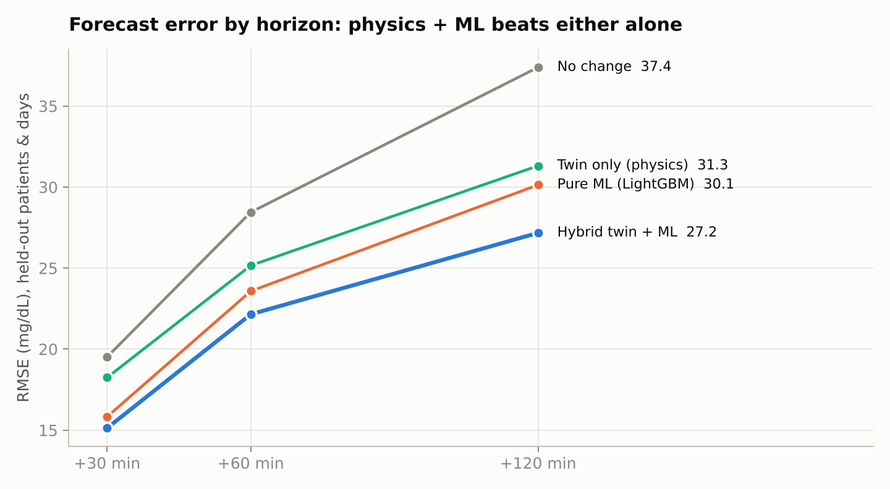
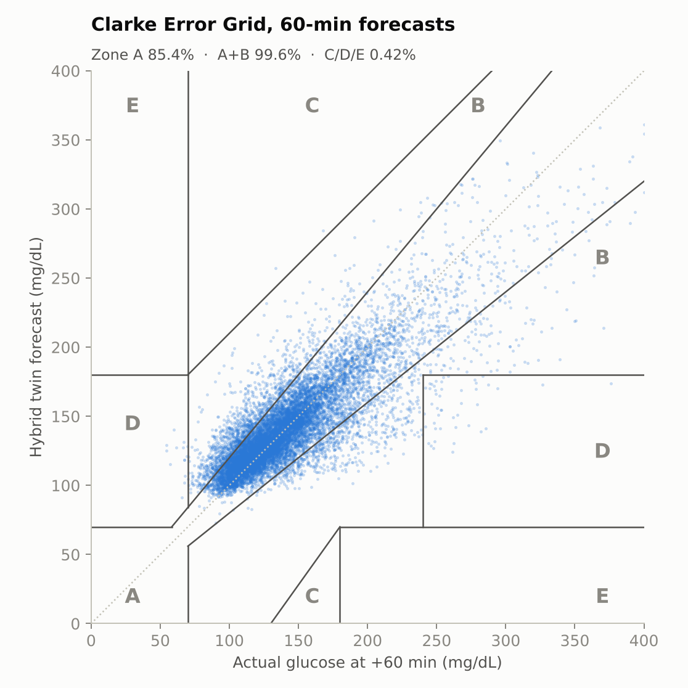
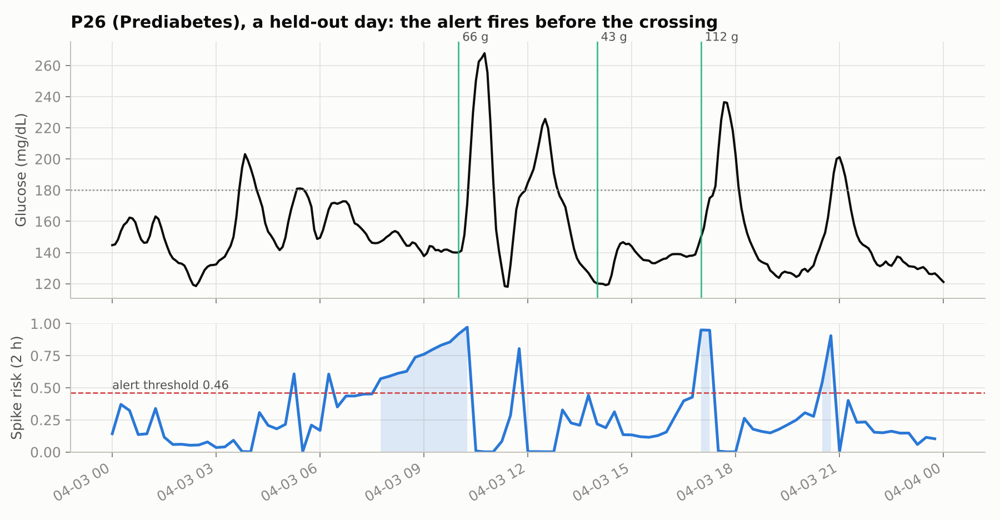
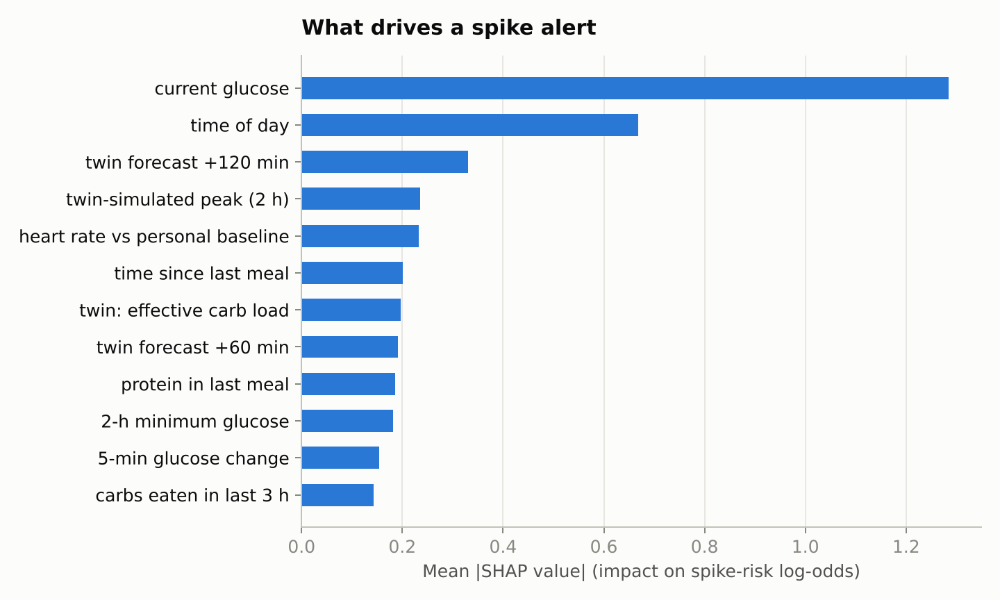
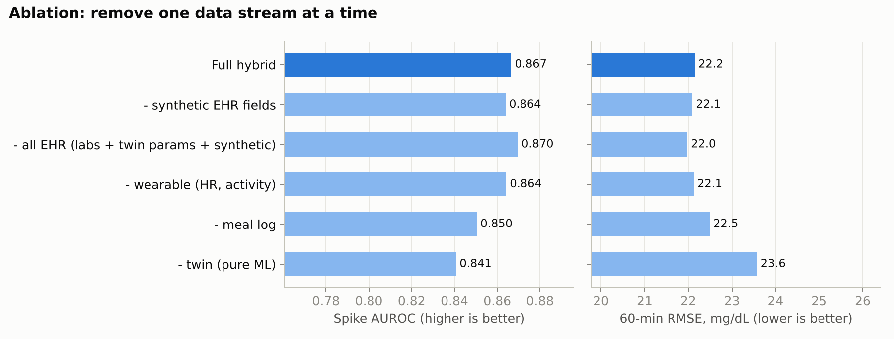

# GlucoTwin: a personal digital twin that warns of glucose spikes before they happen

> Digital Twin Challenge 2026 · Happiest Health · Reimagining & Reforming Healthcare in India Summit

<!-- Generated by scripts/write_readme.py from reports/*.json. Edit docs/README.template.md, not README.md. -->

| | |
|---|---|
| **Live dashboard** | *(deploy link added after Vercel deploy)* |
| **Demo video (unlisted YouTube)** | *(YouTube link added after upload)* |
| **Presentation (PDF)** | [`docs/presentation.pdf`](docs/presentation.pdf) |
| **Architecture diagram (PDF)** | [`docs/architecture.pdf`](docs/architecture.pdf) |
| **Licence** | MIT (code). Data under its own licence, see [Licence](#licence) |



---

## Team and college

| Team name | GlucoTwin |
|---|---|
| Team leader | **Bishal Mandi** (solo team) |
| Programme | B.Tech, Information Technology, 2nd year |
| College | **Indian Institute of Engineering Science and Technology (IIEST), Shibpur**, Howrah, West Bengal |
| GitHub | [@JiroRaiden](https://github.com/JiroRaiden) |

---

## Project title

**GlucoTwin: a personal digital twin for Type 2 diabetes that forecasts glucose and warns of post-meal spikes up to 2 hours ahead.**

## Problem statement

India has about 101 million people with diabetes and 136 million with prediabetes (ICMR-INDIAB, *Lancet Diabetes & Endocrinology*, 2023). Much of the damage happens in the hours after meals: rice- and roti-heavy meals produce sharp glucose spikes, and repeated spikes above 180 mg/dL drive long-term complications. Today a doctor sees these spikes only after the fact, in an HbA1c report or a CGM download, when it is too late to act on that meal.

Two kinds of data could change that, but they live apart:

- **Static records (EHR):** HbA1c, fasting insulin, BMI, diagnoses, medication, family history, genetics.
- **Dynamic signals (wearables):** glucose every 5 minutes, heart rate, activity, meals.

A generic model trained on both still struggles, because **people respond to the same meal very differently**. In our data, carbohydrates alone explain only **2%** of how large a meal's spike is. The question is whether a *personal* model of each patient's physiology, fed by both streams, can predict a spike before it happens and let a doctor test what would prevent it.

## Healthcare use case

**Who:** a diabetologist or primary-care physician managing patients with Type 2 diabetes or prediabetes who wear a CGM.

**What GlucoTwin gives them:**

1. **A virtual patient for each person.** A physiological model of glucose and insulin, calibrated to that patient. It starts from their health record on day 0 and sharpens with every day of wearable data.
2. **Early warning.** Every 15 minutes the twin forecasts glucose 30, 60 and 120 minutes ahead and the probability of crossing 180 mg/dL in the next 2 hours. Each alert comes with its main reasons.
3. **What-if counselling.** The doctor can ask "what if she eats rajma chawal now, half a portion, or the same meal followed by a 20-minute walk?" and see each plan's simulated curve, turning generic diet advice into advice for *this* patient.
4. **Familiar clinical views:** an Ambulatory Glucose Profile, time in range, and the patient's record as a FHIR R4 bundle, the format used by India's Ayushman Bharat Digital Mission (ABDM).

GlucoTwin is **decision support**: it never prescribes, and every alert is for a clinician to review.

---

## Data (anonymised, open and synthetic only)

| Stream | Source | Real or synthetic |
|---|---|---|
| Demographics, BMI, HbA1c, fasting glucose and insulin, lipid panel | [CGMacros](https://physionet.org/content/cgmacros/1.0.0/) `bio.csv` (PhysioNet, open access, anonymised) | Real |
| Dexcom G6 CGM (5 min), FreeStyle Libre Pro (15 min) | CGMacros | Real |
| Fitbit Sense heart rate and METs (1 min) | CGMacros | Real |
| Meals with carbs, protein, fat, fibre | CGMacros | Real |
| Diagnoses (ICD-10), medications, family history, blood pressure, TCF7L2 rs7903146 genotype, polygenic risk, HbA1c history | `glucotwin/data/synthetic_ehr.py` | **Synthetic**, conditioned on each person's real labs, seeded, tagged `synthetic` in every FHIR resource |

**Cohort:** 45 adults over about 10 days of free-living meals: 15 normoglycaemic, 16 prediabetes and 14 Type 2 diabetes, grouped by measured HbA1c with ADA cut-offs (5.7% and 6.5%). 1,684 meals were logged; 1,419 have a clean glucose response (full CGM coverage, no overlapping meal).

**Data-quality findings and fixes:**
- **Two CGMs disagree.** Dexcom and Libre differ by 25% on average. Against each person's lab fasting glucose, Dexcom's overnight level was off by about +12 mg/dL and Libre's by about −27 mg/dL, so **Dexcom is the primary glucose signal**.
- The data dictionary labels HbA1c as mmol/mol, but values span 4.6–8.5, which is the % scale. Treated as %.
- LDL = 800 and VLDL = 400 are documented calculation errors and are set to missing. Fitbit METs are stored ×10 and are rescaled.
- CGM gaps up to 15 min are interpolated, as a CGM receiver does. Longer gaps stay missing, so no physiology is invented.

---

## How it works



### 1. Ingest and align
All streams go on one 5-minute clock (the Dexcom's native rate). Every meal's response is measured: baseline, peak, rise, 2-hour incremental AUC, and whether it crossed 180 mg/dL.

**Evidence that personalisation matters** (out-of-sample R², 5-fold CV, 1,419 meals):

| Predicting a meal's spike from… | R² | MAE (mg/dL) |
|---|---|---|
| Carbs only | 2% | 33 |
| + protein, fat, fibre, baseline glucose, meal type | 0.11 | 31 |
| + fasting labs (HbA1c, HOMA-IR, BMI) | 0.27 | 28 |
| + who the person is | 0.36 | 26 |

For meals with the same 40–70 g of carbohydrate, the glucose rise ranged from 12 to 132 mg/dL (10th to 90th percentile).



### 2. The digital twin (physics)
A reduced **Bergman minimal model** with a two-compartment gut:

```
dQ1/dt = -ka·Q1 + meal                     gut (stomach)
dQ2/dt =  ka·Q1 - ka·Q2                    gut (intestine)
Ra     =  f·ka·Q2·1000 / (VG·BW)           glucose appearing in blood
dG/dt  = -SG·E(t)·(G - Gb) - X·G + Ra
dX/dt  = -p2·X + p2·S·max(G - Gb, 0)       insulin action
E(t)   =  1 + α·max(METs - 1, 0)           exercise speeds clearance
```

Four personal parameters: **SG** (glucose clearance without insulin), **f** (effective carb load: how much glucose each gram of carbohydrate adds), **ka** (absorption speed) and **S** (insulin-driven clearance). Population constants: p2 = 0.025/min, VG = 1.6 dL/kg, and α = 0.3, β = 0.0 chosen by a pooled fit on training data.

**Calibration fuses the two data streams:**
- **Day 0, EHR only.** Ridge regression from labs (HbA1c, HOMA-IR, BMI, fasting glucose, age, triglycerides) to the parameters gives a prior twin.
- **Days 1–7, wearable.** A maximum-a-posteriori fit to CGM meal curves, penalised for leaving the EHR prior. Little data means the record dominates; more data means the patient's own curves take over.
- **Live.** Every 5 minutes the CGM reading nudges the twin's state (data assimilation), so each forecast starts from reality.

**The calibrated twin tells the clinical groups apart** (Kruskal-Wallis across healthy, prediabetes and T2D): glucose clearance **SG**, p = < 0.0001 (median 0.0123 → 0.0028 /min, healthy → T2D); effective carb load **f**, p = 0.00032 (median 0.10 → 0.26). Insulin-driven clearance **S** does not separate the groups (p = 0.39): without plasma insulin it is not identifiable from CGM alone, and we say so rather than over-interpret it.



### 3. Hybrid forecaster (physics + ML)
LightGBM learns the **twin's error**: `forecast(t+h) = twin(t+h) + LGBM_h(features)` for h = 30, 60 and 120 min. A LightGBM classifier gives P(cross 180 mg/dL within 2 h). Features cover CGM level and trend, heart rate, activity, meal timing and macros, labs, twin parameters and the twin's own simulated trajectory. SHAP turns each alert into its top reasons.

### 4. Doctor dashboard
A static web app (`dashboard/`). The twin is ported to JavaScript, so the live forecast and the what-if simulator run in the browser with no server. It includes:
- a patient panel ranked by risk
- the live twin and forecast
- alerts with reasons
- a what-if simulator with an Indian meal library (approximate macros) and a post-meal walk
- a physiology fingerprint
- AGP and time in range
- the FHIR record

A replay control steps through a held-out day, and "Show what happened next" reveals the real glucose.

---

## Results

**Protocol.** Each patient's last 3 days are held out and never used for calibration. The forecaster is trained with 5-fold cross-validation **by patient**, so every score below is on **patients the model never saw, on days the twin never saw**: 14,807 forecast points from 45 patients.

### The twin learns its patient (2-h error on held-out meals)
| Twin calibrated with | RMSE (mg/dL) |
|---|---|
| No change (glucose stays flat) | 39.3 |
| One average twin for everyone | 34.3 |
| EHR only, day 0 | 32.7 |
| 1 / 2 / 3 / 5 days of wearable data | 33.8 / 31.0 / 30.6 / 29.3 |
| All training days | **29.0** |

One day of CGM (3–4 meals) is too little and slightly overfits. From two days on, error falls steadily.



### Forecast accuracy (held-out patients and days)
| Model | RMSE +30 | RMSE +60 | RMSE +120 | Clarke zone A (+60) | Clarke A+B (+60) |
|---|---|---|---|---|---|
| No change | 19.5 | 28.4 | 37.4 | 79.4% | 99.1% |
| Twin only (physics) | 18.2 | 25.2 | 31.3 | 83.9% | 99.4% |
| Pure ML (LightGBM) | 15.8 | 23.6 | 30.1 | 83.1% | 99.4% |
| **Hybrid twin + ML** | **15.1** | **22.1** | **27.2** | **85.4%** | **99.6%** |

The hybrid is best at every horizon. The twin contributes most at longer horizons, where physics matters more than recent trend.

 

### Spike alerts (cross 180 mg/dL within 2 h)
| Model | AUROC, any time | AUROC, at meal start | Events caught | Median lead time | False alarms / patient-day |
|---|---|---|---|---|---|
| Twin only (simulated peak) | 0.669 | 0.784 | 76/232 (33%) | 35 min | 0.2 |
| Pure ML (LightGBM) | 0.840 | 0.827 | 216/232 (93%) | 65 min | 2.2 |
| **Hybrid twin + ML** | **0.864** | **0.858** | **217/232 (94%)** | **90 min** | **2.1** |

**Two kinds of lead time.** People eat at habitual times, so part of a 2-hour-ahead warning comes from knowing the clock ("time of day" is among the top SHAP features). That is useful for anticipation, but it is not physiology. The **meal-start** column isolates the harder question: at the moment a patient logs a meal, before any glucose rise, will this meal take them above 180? It is scored on 513 held-out meals.



### What drives the alerts, and what each data stream adds
Top SHAP features: current glucose, time of day, twin forecast +120 min, twin-simulated peak (2 h), heart rate vs personal baseline, time since last meal.

Ablation scores are averaged per fold, so the full model's AUROC differs slightly from the pooled figure above.

| Features used | Spike AUROC | 60-min RMSE |
|---|---|---|
| Full hybrid | 0.867 | 22.1 |
| - synthetic EHR fields | 0.864 | 22.1 |
| - all EHR (labs + twin params + synthetic) | 0.870 | 22.0 |
| - wearable (HR, activity) | 0.864 | 22.1 |
| - meal log | 0.850 | 22.5 |
| - twin (pure ML) | 0.841 | 23.6 |

How to read the ablation:
- **The twin is the single most valuable input.** Removing it costs the most.
- **The meal log is second.**
- **Heart rate and activity add very little in this cohort.** Their effect is within noise here; the exercise term in the twin still drives the what-if walk.
- **Static EHR fields add nothing on top of the twin**, because their information already enters through the twin's EHR-based prior (an EHR-only twin beats an average twin, see above).
- **The synthetic fields add nothing**, as expected for values generated from labs already in the model.

 

### Limitations
- 45 adults over about 10 days: enough for a proof of concept, not for clinical validation.
- CGMacros participants are US adults; Indian diets and physiology need local validation. Meal-library macros are approximate.
- Plasma insulin was not measured, so insulin secretion and sensitivity cannot be separated (S is not identifiable).
- Diagnoses, medication, genotype and history are synthetic; only labs, CGM, wearables and meals are real.
- Dexcom reads about 12 mg/dL above lab glucose in this cohort, so absolute 180 mg/dL crossings are slightly over-counted.
- Not a medical device. Decision support only.

---

## Tech stack

| Layer | Tools |
|---|---|
| Language | Python 3.11+ |
| Data | pandas, NumPy, PyArrow (Parquet) |
| Twin calibration | SciPy `least_squares` (bounded MAP fit), scikit-learn (ridge EHR prior) |
| ML | LightGBM (residual regressors, spike classifier), SHAP (explanations), scikit-learn (CV, metrics) |
| Clinical evaluation | Clarke Error Grid, ADA and international-consensus CGM metrics (TIR, GMI, CV) |
| Interoperability | FHIR R4 JSON bundles (ABDM-compatible) |
| Dashboard | HTML, CSS, vanilla JavaScript, SVG charts, twin ported to JS, Inter; static site on Vercel |
| Figures and docs | matplotlib; Playwright for the architecture diagram and presentation PDF |

## Repository layout

```
glucotwin/
  config.py                 every clinical threshold, with its source
  data/load.py              CGMacros loader, 5-min alignment, data-quality fixes
  data/meals.py             per-meal glucose response
  data/synthetic_ehr.py     synthetic EHR conditioned on real labs, FHIR R4 export
  twin/model.py             physiological model (JS port in dashboard/app.html)
  twin/calibrate.py         EHR prior + MAP calibration + held-out split
  forecast/features.py      forecast points and features (no look-ahead)
  forecast/models.py        hybrid LightGBM models, alert evaluation
  forecast/clarke.py        Clarke Error Grid
  analysis/                 personalisation evidence and all figures
scripts/                    run_phase1..3, export_dashboard, build_dashboard, make_architecture,
                            make_presentation, screenshot_dashboard, write_readme
dashboard/                  doctor dashboard (static site; deploy this folder)
docs/                       architecture.pdf, presentation.pdf, dashboard screenshots
reports/                    metrics (JSON/CSV) and figures
```

## Run it yourself

```bash
pip install -r requirements.txt
# Download CGMacros (open access, ~630 MB) from https://physionet.org/content/cgmacros/1.0.0/
# and extract it; then point CGMACROS_DIR at the folder that contains bio.csv
export CGMACROS_DIR=/path/to/CGMacros
python scripts/run_phase1.py      # align streams, meal responses, synthetic EHR + FHIR   (~10 s)
python scripts/run_phase2.py      # calibrate a twin per patient, learning curve          (~2 min)
python scripts/run_phase3.py      # hybrid forecaster, cross-validated evaluation         (~4 min)
python scripts/export_dashboard.py && python scripts/build_dashboard.py
# open dashboard/index.html
```

No CGMacros download yet? `python tests/make_mock.py /tmp/mock && CGMACROS_DIR=/tmp/mock python scripts/run_phase1.py` runs the whole pipeline on a small mock dataset in the same format.

---

## Licence

- **Code:** MIT, see [`LICENSE`](LICENSE).
- **Data:** CGMacros is © its authors under **CC BY-NC-SA 4.0**. The raw dataset is **not redistributed** here; each user downloads it from PhysioNet. Derived figures, metrics and the dashboard's replay excerpts (`dashboard/data.js`) are shared under the same CC BY-NC-SA 4.0 terms with attribution.
- **Synthetic EHR fields** are generated by our code and carry no real patient information.

## References

- Gutierrez-Osuna R., Kerr D., Mortazavi B., Das A. *CGMacros: a scientific dataset for personalized nutrition and diet monitoring* (v1.0.0). PhysioNet (2025). https://doi.org/10.13026/3z8q-x658
- Goldberger A. *et al.* PhysioBank, PhysioToolkit and PhysioNet. *Circulation* 101(23) (2000).
- Anjana R.M. *et al.* Metabolic non-communicable disease health report of India: the ICMR-INDIAB national cross-sectional study. *Lancet Diabetes Endocrinol* (2023).
- Bergman R.N. *et al.* Quantitative estimation of insulin sensitivity. *Am J Physiol* 236 (1979).
- Dalla Man C., Rizza R.A., Cobelli C. Meal simulation model of the glucose-insulin system. *IEEE TBME* 54 (2007).
- Clarke W.L. *et al.* Evaluating clinical accuracy of systems for self-monitoring of blood glucose. *Diabetes Care* 10 (1987).
- Battelino T. *et al.* Clinical targets for CGM data interpretation: recommendations from the international consensus on time in range. *Diabetes Care* 42 (2019).
- American Diabetes Association. *Standards of Care in Diabetes* (HbA1c diagnostic thresholds, post-prandial target).
